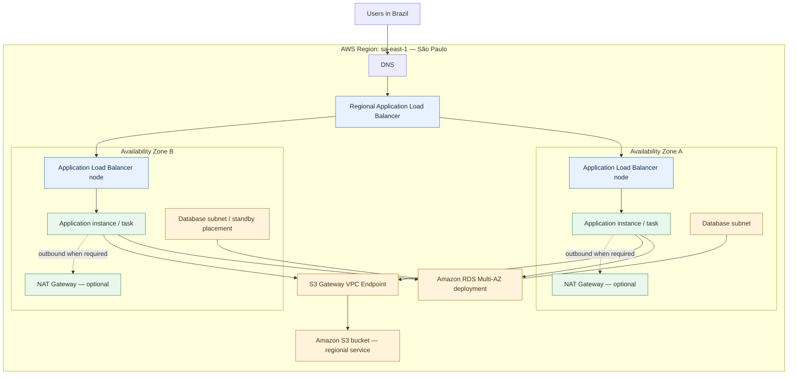

# Lab 01 — AWS Fundamentals: Global Infrastructure

**Status:** In progress  
**Focus:** AWS Regions, Availability Zones (AZs), AZ IDs, and architecture for high availability.

## 1. Learning objectives

By the end of this lab, you should be able to:

- Explain the difference between an AWS Region and an Availability Zone.
- Explain why distributing workloads across AZs improves resilience.
- Distinguish global, regional, and zonal resource scopes.
- Explain when AZ IDs are useful, especially in multi-account architectures.
- Propose a highly available architecture for a web application used primarily in Brazil.
- Explain the limitations of local emulation when studying AWS physical infrastructure.

## 2. AWS global infrastructure

### AWS Region

An AWS Region is a separate geographic area. Regions are designed to be isolated from one another to support fault tolerance and stability. Most AWS resources are created in a specific Region, and resources are not automatically replicated between Regions unless a service or architecture is configured to do so.

Examples:

| Region name | Region code |
|---|---|
| South America (São Paulo) | `sa-east-1` |
| US East (N. Virginia) | `us-east-1` |
| US East (Ohio) | `us-east-2` |
| Europe (Ireland) | `eu-west-1` |
| Europe (Frankfurt) | `eu-central-1` |
| Asia Pacific (Tokyo) | `ap-northeast-1` |

When selecting a Region, evaluate at least:

- Proximity to users and measured network latency.
- Availability of the AWS services and features required by the workload.
- Regulatory, privacy, and data-residency requirements.
- Pricing, including data transfer and cross-Region traffic.
- Resilience and disaster-recovery requirements.

A Region close to users is a strong starting point, not an automatic answer. Validate the actual workload requirements.

### Availability Zone (AZ)

An Availability Zone is an isolated location within an AWS Region. An AZ consists of one or more discrete data centers with independent, redundant power, networking, and connectivity.

A workload deployed in only one AZ can be affected if that AZ becomes unavailable. Distributing application components across multiple AZs can allow the workload to continue operating during certain AZ-level failures, provided that the application and its dependencies are designed for failover.

### AZ names and AZ IDs

An AZ name such as `sa-east-1a` is an account-facing identifier. In Regions with independently mapped AZ names, the same AZ name may refer to different physical locations in different AWS accounts. An AZ ID, such as `sae1-az1`, is a consistent identifier for the physical AZ across accounts.

Use AZ IDs when you need to coordinate placement across accounts—for example, when sharing subnets or designing multi-account network architectures. Always inspect the AZ names and IDs available to the account and Region you are using.

## 3. Global, regional, and zonal scope

These labels describe where a resource is defined or operates. They are useful design concepts, but service behavior must always be checked in that service's documentation.

| Scope | Example | What it means |
|---|---|---|
| Global | AWS IAM | IAM identities and policies are not created separately in each Region. |
| Regional | Amazon VPC | A VPC belongs to one Region and can span multiple AZs in that Region. |
| Zonal | Subnet | A subnet belongs to one AZ. A VPC can contain subnets in several AZs. |
| Zonal placement | EC2 instance | An EC2 instance is launched into a subnet and therefore into one AZ. |
| Regional service with multi-AZ deployment | Application Load Balancer / Amazon RDS Multi-AZ | The service can use resources or infrastructure across multiple AZs, depending on configuration. |

Do not infer scope from a service name alone. Check the specific resource and feature documentation.

## 4. High-availability design principles

For a web application that must tolerate an AZ failure, a common starting point is:

1. Deploy an internet-facing Application Load Balancer across at least two public subnets in different AZs.
2. Place application compute in private subnets in at least two AZs.
3. Run multiple application instances or tasks and configure health checks and replacement/scaling behavior.
4. Place the database in private database subnets across AZs and select an appropriate Multi-AZ database deployment when the engine and requirements support it.
5. Store uploaded files in an S3 bucket in the selected Region. For S3 Standard, AWS manages data redundancy across multiple AZs; the application can use an S3 VPC gateway endpoint to access S3 without routing that traffic through a public internet gateway or NAT Gateway.
6. Add monitoring, backups, alerts, and tested recovery procedures.

Multi-AZ architecture improves availability, but it does not automatically guarantee zero downtime. Application state, session handling, database failover behavior, capacity, DNS, deployment strategy, and dependent services all matter.

## 5. Architecture diagram

The following Mermaid diagram is rendered by GitHub. The editable source is also available in [`architecture.mmd`](./architecture.mmd).

## 6. Floci lab boundary

Floci is useful for exercising supported AWS-compatible APIs locally. It does **not** reproduce the physical AWS Region/AZ geography, independent data centers, real AWS network fabric, or every managed-service behavior.

The architecture in this lab is therefore a design exercise. We will implement selected API-level resources in Floci where supported, and use an AWS sandbox account when real networking, AZ placement, managed database failover, or other cloud-specific behavior must be validated.

## 7. Hands-on questions

Answer these in your own words:

1. What is the difference between a Region and an AZ?
2. Why is placing all EC2 instances in one AZ a single-location risk?
3. What is an AZ ID, and when is it especially useful?
4. Why can a VPC span several AZs while a subnet belongs to one AZ?
5. Why does multi-AZ deployment not automatically mean zero downtime?

## 8. Validation checklist

- [ ] I can explain Region vs. AZ without looking at the notes.
- [ ] I can explain the purpose of AZ IDs.
- [ ] I can identify global, regional, and zonal examples.
- [ ] I can explain the architecture diagram.
- [ ] I can describe at least three failure scenarios and their mitigations.
- [ ] I completed the quiz and documented my own challenge answer.

## 9. Troubleshooting and lessons learned

Record what you tested, what happened, and what you learned.

| Date | Experiment | Result | Lesson learned |
|---|---|---|---|
| YYYY-MM-DD | Read AWS global infrastructure documentation | Pending | Pending |

## 10. Official references

- [AWS Regions and Availability Zones](https://docs.aws.amazon.com/global-infrastructure/latest/regions/aws-regions-availability-zones.html)
- [AWS Regions](https://docs.aws.amazon.com/global-infrastructure/latest/regions/aws-regions.html)
- [AZ IDs](https://docs.aws.amazon.com/global-infrastructure/latest/regions/az-ids.html)
- [Amazon VPC — What is Amazon VPC?](https://docs.aws.amazon.com/vpc/latest/userguide/what-is-amazon-vpc.html)
- [Amazon S3 data protection and availability](https://docs.aws.amazon.com/AmazonS3/latest/userguide/DataDurability.html)
- [Amazon RDS Multi-AZ deployments](https://docs.aws.amazon.com/AmazonRDS/latest/UserGuide/Concepts.MultiAZ.html)

---

**Next lab:** VPC fundamentals — CIDR, subnets, route tables, internet gateways, NAT, and security groups.
